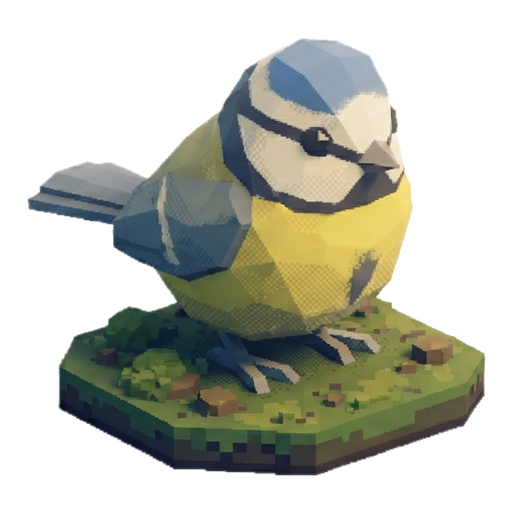

<p align="center"></p>

# Birdstation

Frontend de **Super Nintendo (SNES)** para Windows, com biblioteca de jogos em grade de capas
(no estilo do DuckStation). Escrito em C++17 com SDL2 e Dear ImGui; a emulação é feita pelo
núcleo **Snes9x** (via libretro).

* Biblioteca com **capas**, busca, zoom das capas, navegação por teclado e gamepad
* **Download automático de capas** (libretro-thumbnails) ou capas próprias
* **Gamepad via SDL2** (Xbox, DualShock/DualSense, Switch Pro, etc.) com hot-plug, 2 jogadores
* **Remapeamento** de teclado e gamepad (janela *Controles*)
* **Save states** em 10 slots por jogo + salvamento automático da SRAM (save da bateria)
* Tela cheia, filtro bilinear ou pixel-perfeito, escala inteira, volume, avanço rápido, pausa
* **Portátil**: tudo fica na pasta do programa. Descompacte e rode.

## Uso rápido (versão .zip)

1. Baixe `Birdstation-x.y.z-win64.zip` em **Releases** e descompacte onde quiser.
2. Coloque suas ROMs (`.sfc`, `.smc`, `.swc`, `.fig`) na pasta `roms\` (ou use *Configurações → Adicionar pasta*).
3. Abra `Birdstation.exe` → clique em **Baixar capas** → dê duplo clique em um jogo.

Também dá para arrastar uma ROM para a janela, ou associar `.sfc/.smc` ao `Birdstation.exe`.

Estrutura da pasta (criada automaticamente):

```
Birdstation\
  Birdstation.exe
  cores\snes9x_libretro.dll   núcleo de emulação
  roms\                       suas ROMs
  covers\                     capas (<nome da rom>.png/.jpg)
  saves\                      SRAM (.srm)
  states\                     save states (<rom>.state0 ... state9)
  config\birdstation.ini      configurações e mapeamento de controles
```

## Controles padrão

| SNES | Teclado | Gamepad (Xbox) |
|---|---|---|
| D-Pad | Setas | D-Pad / analógico esquerdo |
| B / A | Z / X | A / B |
| Y / X | A / S | X / Y |
| L / R | Q / W | LB / RB |
| Start / Select | Enter / Shift direito | Start / Back |

Tudo pode ser alterado em **Controles** (clique no botão e pressione a nova tecla/botão).
O segundo gamepad controla o Jogador 2.

### Atalhos

| Tecla | Ação |
|---|---|
| F5 / F7 | Salvar / carregar estado no slot atual |
| F2 / F3 | Slot anterior / próximo (1–10) |
| F10 | Reiniciar |
| P | Pausar |
| Tab (segurar) | Avanço rápido |
| F11 ou Alt+Enter | Tela cheia |
| F1 ou botão Guide | Mostrar/ocultar o menu |
| Esc | Voltar à biblioteca |

Na biblioteca: setas/D-Pad navegam, **Enter/A** joga, LB/RB pulam linhas.
Arraste uma imagem sobre a janela para definir a capa do jogo selecionado.

## Compilando

Requisitos: **Visual Studio 2022** (C++ para desktop) e **CMake 3.21+**. O SDL2 é baixado e
compilado automaticamente pelo CMake; Dear ImGui, stb e `libretro.h` já estão em `third_party/`.

```powershell
cmake -S . -B build -A x64
cmake --build build --config Release
powershell -ExecutionPolicy Bypass -File scripts\fetch-core.ps1 -Dest build\Release\cores
build\Release\Birdstation.exe
```

### Gerar o .zip portátil

```powershell
scripts\package.ps1 -Version 1.0.0     # ou dê duplo clique em Criar-Pacote.bat
```

Gera `dist\Birdstation-1.0.0-win64.zip` com o executável, o núcleo Snes9x e as pastas prontas.

## Publicando no GitHub

```powershell
git add .
git commit -m "Birdstation 1.0.0"
git remote add origin https://github.com/<seu-usuario>/Birdstation.git
git push -u origin main
git tag v1.0.0 && git push origin v1.0.0
```

O workflow `.github/workflows/build.yml` compila no GitHub Actions a cada push e, ao enviar uma
tag `v*`, publica o `.zip` automaticamente em **Releases**.

## Arquitetura

| Arquivo | Função |
|---|---|
| `src/core.*` | Host libretro: carrega `snes9x_libretro.dll`, vídeo, áudio, entrada, save states, SRAM |
| `src/input.*` | Teclado + SDL_GameController, hot-plug, captura para remapeamento |
| `src/library.*` | Varredura de ROMs, cache de capas (texturas sob demanda), downloader (WinHTTP) |
| `src/config.*` | `birdstation.ini` |
| `src/app.*` | Janela, loop principal, tela de biblioteca, menu do jogo, janelas de controles/configurações |

Como o núcleo é um módulo libretro, é possível trocar o Snes9x por outro núcleo SNES compatível
(por exemplo `bsnes`/`mesens`) substituindo o arquivo em `cores\` com o nome `snes9x_libretro.dll`.

## Licenças

Código do Birdstation: **MIT** (`LICENSE`). Terceiros em `THIRD_PARTY_NOTICES.md`.
O Snes9x tem licença **não comercial**; o núcleo é baixado do build bot oficial do libretro e não faz
parte do código-fonte. O projeto **não inclui ROMs** — use apenas jogos que você possui legalmente.
